<div align="center">

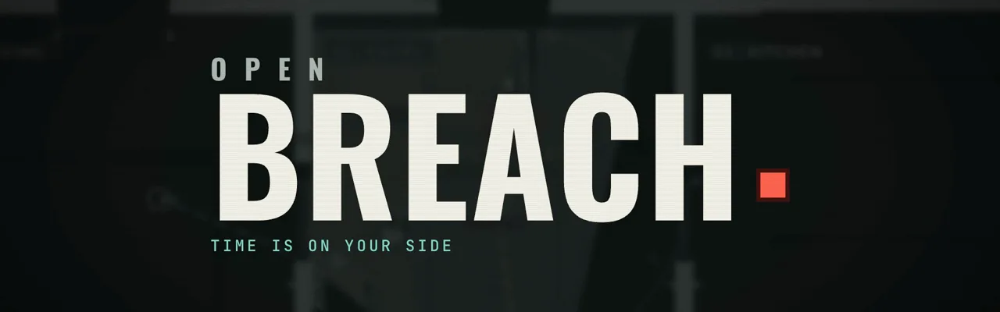

### 모든 진입을 계획하고, 시간을 멈추고, 함께 돌입하라.

브라우저에서 바로 실행되는 탑다운 전술 분대 게임입니다.<br/>
무료 오픈소스이고, 설치·계정·서버가 필요 없습니다.

[](https://devjay4561.github.io/open-breach/)
[](.github/media/trailer.mp4)


[](LICENSE)
[](ASSETS-LICENSE.md)

[English](README.md) · **한국어**

<a href=".github/media/trailer.mp4">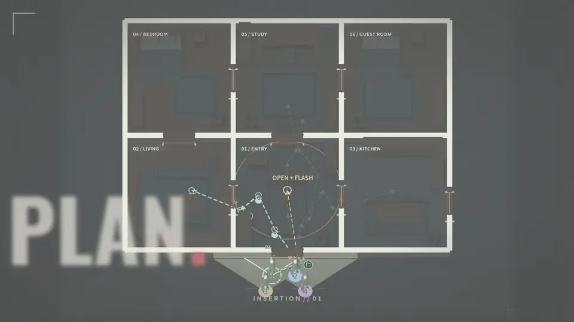</a>

<sub>▲ 실제 게임 플레이 화면입니다. 클릭하면 소리가 있는 53초 트레일러를 볼 수 있습니다.</sub>

</div>

---

## 핵심 루프

<table>
<tr>
<td width="33%" valign="top">
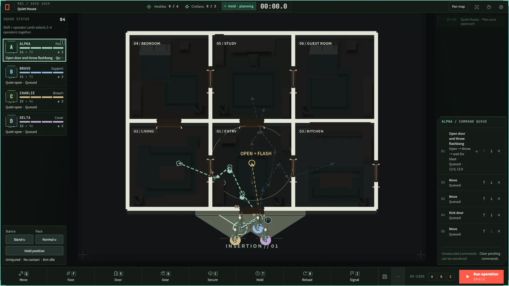
<h3>01 · 계획</h3>
경로를 그리고, 문 앞에 대원을 붙이고, 섬광탄을 예약하세요. 모든 명령은 순서를 바꾸거나 타이밍을 맞추거나 고코드에 묶을 수 있습니다.
</td>
<td width="33%" valign="top">
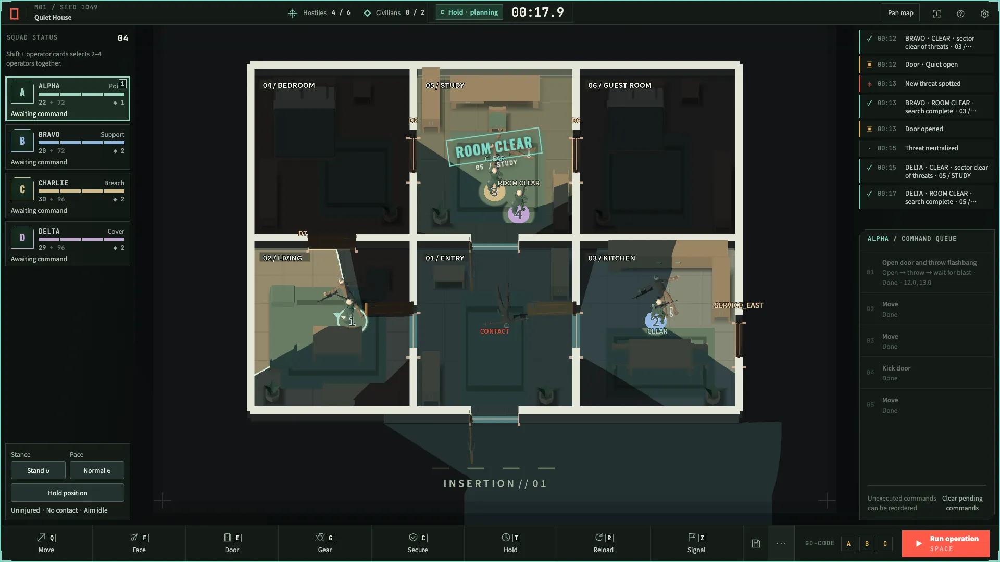
<h3>02 · 정지</h3>
시간은 당신이 허락할 때만 흐릅니다. 교전 중에 멈추고 상황을 읽은 뒤 계획을 고쳐 다시 실행하세요.
</td>
<td width="33%" valign="top">
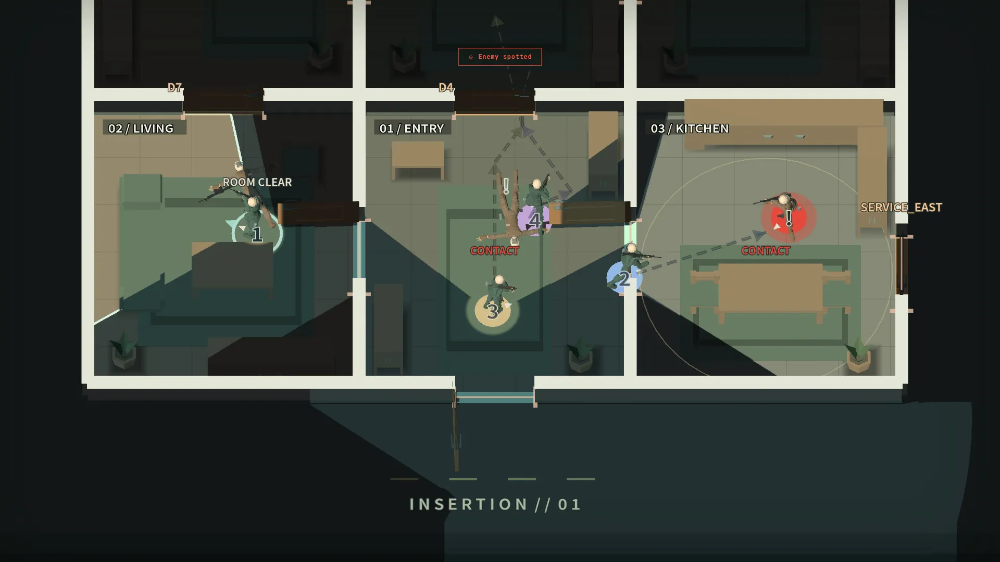
<h3>03 · 진입</h3>
문이 열리고 섬광이 터지면 실제 시야에 따라 교전이 벌어집니다. 방 하나씩 확보하세요.
</td>
</tr>
</table>

## 특징

- **작전 24개:** 작전 목록의 임무 12개(튜토리얼, 캠페인, 변형 임무)와 가상의 특수 작전 12개가 있습니다. 특수 작전에는 여객기, 선박, 시설 등이 등장합니다.
- **4인 분대:** 이동, 주시, 문 처리, 장비, 확보, 대기, 재장전, 신호 명령을 내릴 수 있습니다. 고코드 A/B/C로 동시에 움직입니다.
- **문과 섬광탄:** 문을 열거나, 차거나, 폭약으로 부술 수 있습니다. 명령 하나로 문을 열고, 섬광탄을 던지고, 폭발을 기다렸다가 진입합니다.
- **실제 시야:** 벽, 문, 가구가 경로와 시야를 가립니다. 교전은 각 대원이 실제로 보는 것에 따라 자동으로 처리됩니다.
- **장비 편성:** 대원마다 소총, 권총, 방어구, 헬멧, 조준경, 소음기, 진입 도구를 고를 수 있습니다. 이름, 콜사인, 색상, 패치도 정할 수 있습니다.
- **결정론적 리플레이:** 모든 플레이가 기록됩니다. 되감고, 대원을 따라가며 보고, 작은 JSON 파일로 공유할 수 있습니다.
- **성장 요소:** 시드 배치, 별 과제, 오늘의 작전, 해금, 아홉 작전짜리 캠페인이 있습니다.
- **맵 에디터:** 직접 만든 훈련장을 계획과 함께 공유할 수 있습니다.
- **어디서나 실행:** Godot 4.7로 만든 30Hz 시뮬레이션을 WebAssembly로 컴파일했습니다. 진행 기록은 내 컴퓨터의 IndexedDB에 저장됩니다.

## 갤러리

<table>
<tr>
<td>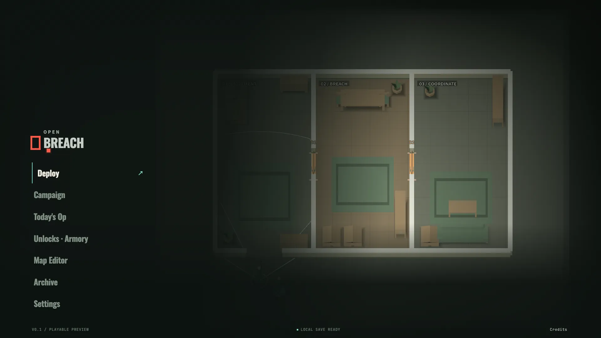</td>
<td>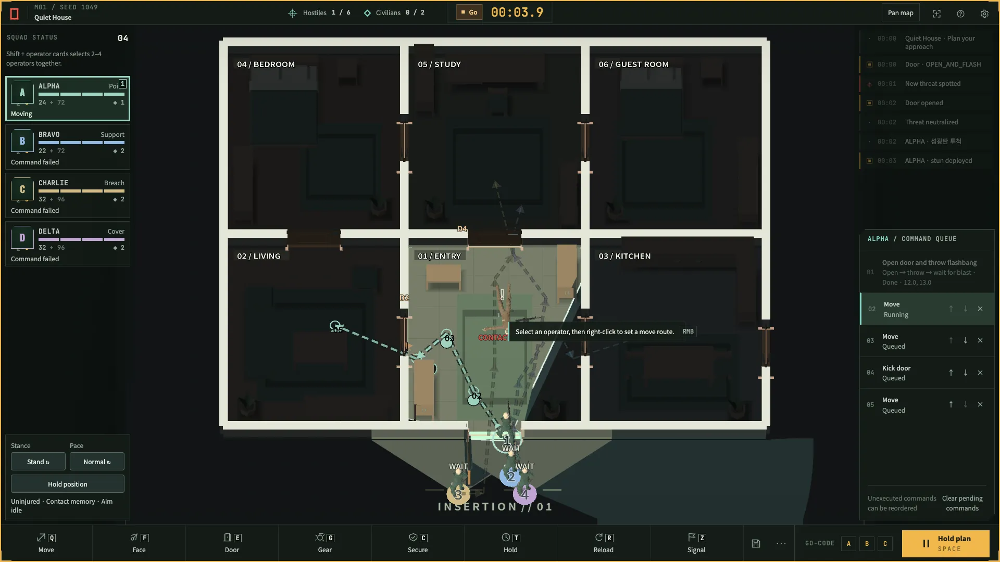</td>
</tr>
<tr>
<td>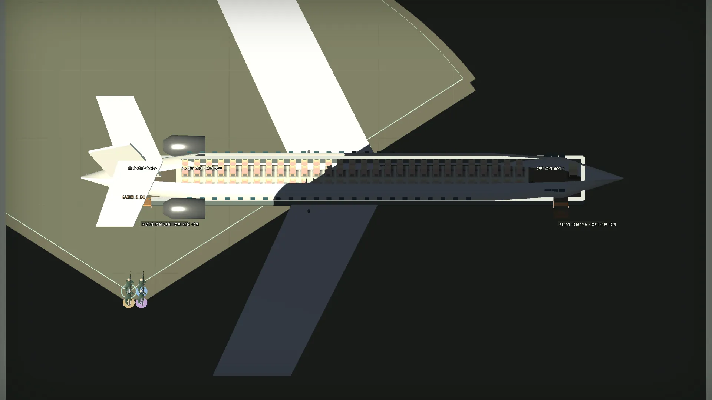</td>
<td>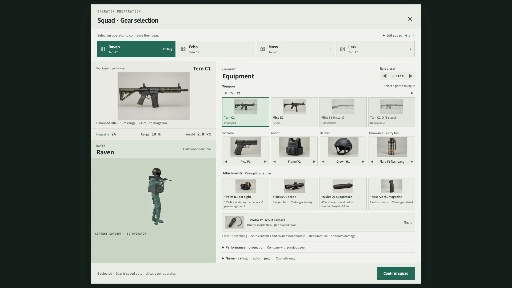</td>
</tr>
<tr>
<td>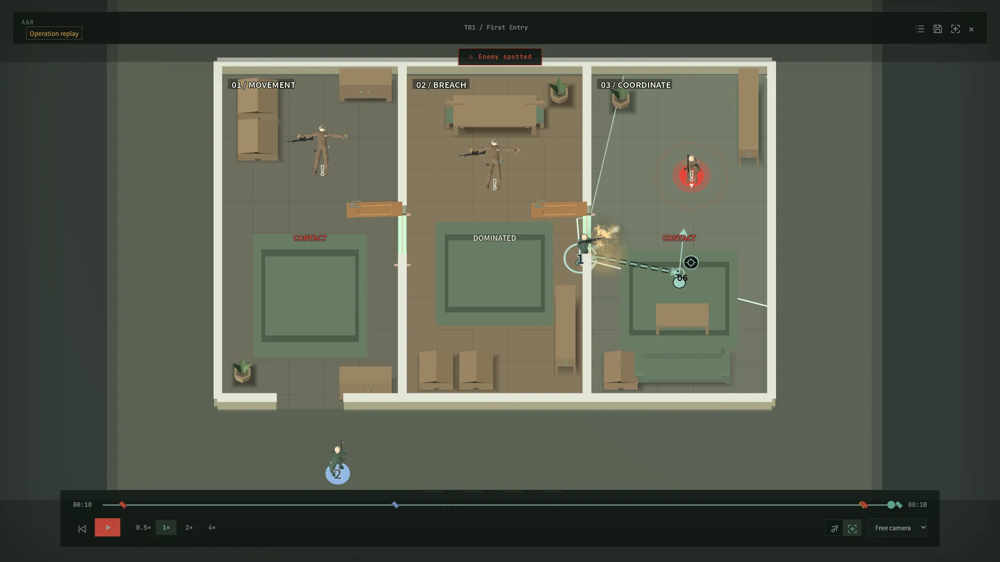</td>
<td>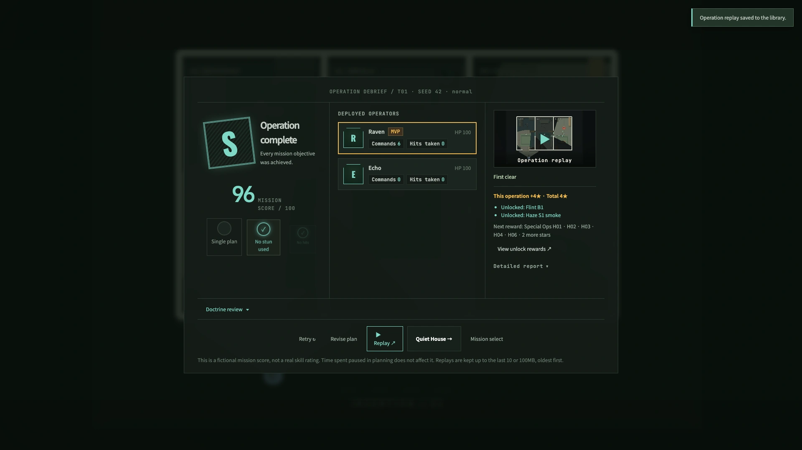</td>
</tr>
</table>

## 빠른 시작

**온라인 플레이:** [devjay4561.github.io/open-breach](https://devjay4561.github.io/open-breach/)

**로컬 실행**에는 Node.js 20 이상과 Python 3가 필요합니다.

```sh
git clone https://github.com/devjay4561/open-breach.git
cd open-breach
npm run build
npm start          # → http://127.0.0.1:8080
```

macOS에서는 [`Play.command`](Play.command)를 더블클릭해도 됩니다. HTML 파일을 직접 열면 실행되지 않으니 로컬 서버를 사용하세요. WebGL 2와 WebAssembly를 지원하는 데스크톱 브라우저가 필요합니다.

> [!TIP]
> 진행 상황, 설정, 계획, 최근 리플레이는 브라우저에 저장됩니다. 사이트 데이터를 지우면 함께 지워지므로 남기고 싶은 계획과 리플레이는 내보내 두세요.

## 조작

| 동작 | 기본 키 |
| --- | --- |
| 대원 선택 | 대원 카드 또는 <kbd>1</kbd>–<kbd>4</kbd> |
| 이동 계획 | 바닥 <kbd>우클릭</kbd> · <kbd>Shift</kbd> + <kbd>우클릭</kbd>으로 경유점 추가 |
| 문 처리 | 문 클릭 · 우클릭으로 열기·차기·섬광탄 |
| 실행 / 정지 | <kbd>Space</kbd> |
| 주시 / 재장전 | <kbd>F</kbd> 후 클릭 · <kbd>R</kbd> |
| 화면 이동 / 줌 / 시점 복원 | <kbd>W</kbd><kbd>A</kbd><kbd>S</kbd><kbd>D</kbd> · 마우스 휠 · <kbd>Home</kbd> |
| 취소 / 메뉴 | <kbd>Esc</kbd> |

처음에는 튜토리얼부터 시작하세요. 게임 안의 도움말과 설정에서 게임패드를 포함한 모든 동작과 키 배치를 볼 수 있습니다.

## 소스에서 빌드

저장소에 포함된 [`runtime/web/`](runtime/web/) 덕분에 Godot 없이도 `npm run build`로 `dist/`를 만들 수 있습니다. 게임 자체를 수정하려면 **Godot 4.7.x**와 같은 버전의 웹 내보내기 템플릿을 설치하세요. 저장소의 빌드와 설치 스크립트는 **4.7.2** 기준입니다.

```sh
bash scripts/setup.sh        # 또는: python3 scripts/setup_tools.py
npm run build:engine
npm run build
```

Godot에서 [`game/project.godot`](game/project.godot)를 열거나 `GODOT_BIN`에 실행 파일 경로를 지정하세요. 설치 스크립트는 macOS와 Linux를 지원합니다. Windows에서는 같은 버전의 에디터와 웹 템플릿을 직접 설치해야 합니다. `npm run build -- --portable`은 검증된 사전 빌드만 패키징하며, 소스와 런타임 해시가 일치해야 합니다.

<details>
<summary><b>배포</b></summary>

`dist/`의 내용을 정적 호스팅에 올리면 됩니다. **Settings → Pages → Source**를 **GitHub Actions**로 설정하면, 포함된 [GitHub Pages 워크플로](.github/workflows/pages.yml)가 `main`에 푸시할 때마다 빌드하고 배포합니다. 단일 스레드 빌드라서 `/open-breach/` 같은 하위 경로에서도 COOP/COEP 헤더 없이 동작합니다.

</details>

<details>
<summary><b>테스트</b></summary>

30개 시드의 방 진입 검사에서 대원 4명이 원래 목표 지점에 도착하는 시간은 **6.73초 → 3.00초**로 개선됐습니다. 대원별 평균 문턱 체류 시간은 **1.158초**, 동일 조건의 수동 계획은 **1.542초**로 **24.9% 감소**했습니다. 문턱 체류 시간은 비교용으로 기록하며 테스트의 통과·실패 기준으로 사용하지 않습니다.


```sh
npm ci
npm test            # Godot 헤드리스 테스트 (Godot 필요)
npm run test:meta
npm run test:build
```

새로 클론한 상태에서 실행 파일을 직접 지정할 때는 먼저 `"$GODOT_BIN" --headless --path game --import`를 실행하세요. 브라우저 테스트에는 Playwright와 실행 중인 게임이 필요합니다.

```sh
npx playwright install chromium
npm start
npm run test:browser   # 다른 터미널에서
```

</details>

<details>
<summary><b>저장소 구조</b></summary>

| 경로 | 내용 |
| --- | --- |
| [`game/`](game/) | Godot 시뮬레이션, 렌더링, 임무 데이터, 엔진 테스트 |
| [`web/`](web/) | 브라우저 UI, 설정, 저장, 웹 에셋 |
| [`runtime/web/`](runtime/web/) | 검증된 사전 빌드 브라우저 엔진 |
| [`scripts/`](scripts/) · [`tests/`](tests/) | 빌드 도구와 자동 검사 |
| [`assets/source/`](assets/source/) | 편집 가능한 에셋 원본 |
| [`licenses/`](licenses/) · [`asset-manifest.json`](asset-manifest.json) | 고지, 출처, 해시 |

</details>

## 라이선스와 크레딧

| | 라이선스 |
| --- | --- |
| 코드 | [MIT](LICENSE) © 2026 ijaehyeon |
| 자체 제작 맵·모델·사운드·아트·트레일러 | 권리를 보유한 범위에서 [CC0 1.0](licenses/CC0-1.0.txt) |
| 캐릭터·무기·모션 | Quaternius(Toon Shooter, Modular Characters), Kay Lousberg의 KayKit Character Animations, 모두 CC0 |
| 가구·자연물·파티클·충격음 | Kenney, CC0 |
| 총성 | Free Firearm Sound Library, CC0 |
| 폰트 | Noto Sans KR, Oswald, JetBrains Mono, [SIL OFL 1.1](licenses/) |
| 엔진 | [Godot Engine](https://godotengine.org), MIT, [제3자 고지](licenses/Godot-COPYRIGHT.txt) 포함 |

경로별 상세 내역은 [ASSETS-LICENSE.md](ASSETS-LICENSE.md)에, 정확한 출처와 해시는 [asset-manifest.json](asset-manifest.json)에 있습니다.

> [!NOTE]
> 모든 작전, 장소, 조직과 등장인물은 가상입니다. 실제 사건과의 유사성은 우연입니다.
